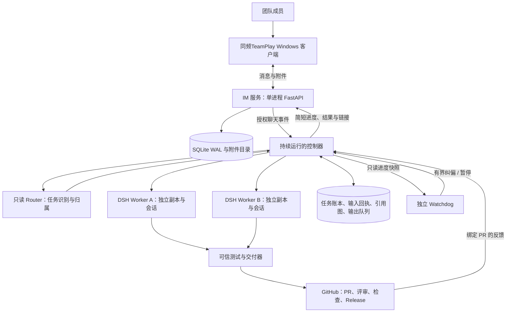

# 同频TeamPlay

小团队私有聊天工具：Windows 客户端，支持私聊、群聊、文字、图片、音频、视频和文件。每个附件严格小于 **100,000,000 字节**。团队可以在授权群里讨论需求，让 DeepSeek Harness（DSH）在指定代码项目中执行、测试，再把结果送回聊天与 GitHub。

当前产品版本 **v0.3.2**。本版统一显示名称并整理设计与业务流程，执行架构沿用 v0.3.0。Windows 下载见 [v0.3.2 Release](https://github.com/walcracia/agent_bot_im/releases/tag/v0.3.2)；开发运行见 [workspace/README](workspace/README.md)，重启或换机器先读 [RESTORE](RESTORE.md)。

## 是否符合文章的 Super-agent 概念

**符合主要架构思想，已实现单项目团队编码的核心结构；自动交付仍有两项P1缺陷，上下文等能力也只是部分实现。** 不能据此认为已具备可直接无人值守的可信自动发布。这个判断结合源码和远端已保留审计，不代表官方认证，也不意味着所有模型、任务规模或长期运行场景都已验证。

对照的是 DeepSeek Harness 团队的[《Super-agent 设计探索：迈向更自主的 Agent 系统》](https://mp.weixin.qq.com/s/zoS7GlReWPhfCjENGxXCdg)（2026-10-31），以及文章链接的[官方研究原型](https://github.com/deepseek-ai/dsh-superagent-prototype)。文章讨论连续、高效、主动、持久的工作方式；原型明确属于研究探索。以下是本项目对这些思想的实现判断，不能把原型的模拟评测当成本项目的真实代码质量证据。

| 核对项 | 当前判断 | 源码中的实际行为与边界 |
| --- | --- | --- |
| 连续：聊天到代码评审保持同一任务 | 核心机制存在，有交付窗口缺陷 | IM 需求、绑定 PR 的反馈沿任务编号、工作副本和原生会话接续；重启保留账本。但交付期间新增补充可能已确认却未执行。 |
| 高效：接收、判断、执行相互分开 | 已实现核心机制 | 控制器持续收消息，按批调用只读 Router；每任务 Worker 独立执行，默认最多两项并行。常驻的是控制器进程，Router 每批新调用，不能声称它永久记住全部讨论。 |
| 主动：普通讨论也可引发核查 | 有条件实现 | 显式启用主动核查及可信交付后，可静默调查普通缺陷讨论；正常路径没有可靠结果时保持安静，重启仍可能误发通知。并非任何群、任何成员都能触发。 |
| 持久：状态与执行环境分离 | 已实现基础能力 | 事件、输入、任务、原生消费回执、输出和交付阶段持久保存；可接独立工具 daemon。仍是单控制器的本地持久状态，不是分布式高可用或无限长期记忆。 |
| 运行中接纳新输入 | 已实现，抢占与交付有边界 | 使用原生 `agent.steer`，保存原生消息与序号回执；Worker运行/收尾期的迟到输入进入同会话下一轮，交付期仍可能遗漏。回执证明接纳，不证明模型已正确遵循，也不保证长工具立即停止。 |
| Thread、引用与按需召回 | 部分实现 | 有消息/任务/PR/结果引用图和 Worker 的 `context_read` 分页；没有完整通用订阅引擎、全局上下文预算或历史自动压缩。 |
| 独立语义监督 | 已实现受限版本 | 独立进程和只读模型会话判断偏离、停滞与循环，有界纠偏或暂停。没有开放模型自行改系统规则/权限；与文章全工具监督方案存在刻意差异。 |

文章中的实时共同操作、跨实例协作、组织级长期记忆仍涉及探索问题；本项目不宣称已经完成。自动合并、自动发版是这里增加的交付能力，不能仅凭这些功能判断是否为 Super-agent。概念来源可继续读官方[领域模型](https://github.com/deepseek-ai/dsh-superagent-prototype/blob/main/docs/001-domain.md)与[架构文档](https://github.com/deepseek-ai/dsh-superagent-prototype/blob/main/docs/007-architecture.md)。

## 团队、IM、DSH 与代码项目怎样协作

| 参与者 | 负责什么 |
| --- | --- |
| 团队成员 | 提出问题、补充要求、查看进度、判断结果是否满足业务需要。 |
| 管理员/项目维护者 | 创建账号与助手，绑定允许的群、成员、项目、测试及交付策略，处理暂停和权限问题。 |
| 同频TeamPlay | 保存聊天与附件，控制访问，提供桌面操作入口，把授权事件交给控制器并展示简短结果。 |
| 控制器与 Router | 持续接收事件、识别新任务或已有任务输入、调度并发。Router 只读分类，不直接改代码。 |
| DSH Worker | 在每项任务自己的 Git 工作副本、分支和原生会话中理解需求、修改代码、执行工具与测试。 |
| Watchdog | 作为外部监督者查看进度证据，必要时提出一次纠偏、暂停或通知人员。 |
| GitHub 与交付器 | 保存可审查的差异、评审、检查及版本资产；按可信策略确认准确代码版本后合并和构建。 |



IM 服务器负责通信，DSH 执行环境负责代码工作，两者可分别部署。Windows 聊天客户端不包含服务器或 DSH。项目绑定决定 Worker 操作哪个仓库，群里的一条消息不能改绑项目或放宽权限。

双击 `TeamRelay.exe` 只打开Electron客户端，不会执行后台 `start.ps1`；统一启动IM/DSH/监督由脚本入口完成，关闭窗口不等于停后台。Tauri尚未迁移。

## 一项需求从讨论到交付

1. **管理员先绑定。** 创建助手并加入指定聊天，允许派任务的成员也需明确配置。选择一个项目及独立工作副本，配置 DSH、可信测试和 GitHub 策略。首次启用自动识别时跳过旧消息，避免历史讨论突然开始编码。
2. **成员正常讨论或明确交办。** 服务保存消息，控制器持续补读。先按群、成员与机器人身份过滤，再交给只读 Router 判断新任务、补充、状态、停止、继续、忽略或主动核查。机器人自己的回复不会再次触发自己。
3. **任务入账并取得编号。** 例如 `T000001`。任务持有来源引用、需求、状态、工作副本、分支和原生会话映射。归属不明时要求指定编号；新任务排队，同一任务不重入。
4. **Worker 执行。** 建立独立 `codex/super/<任务号>` 分支与 worktree，调用已安装 DSH。默认最多两项并行，每次 Worker 调用默认上限两小时；同一任务接续可以产生多轮，具体由本机可信配置决定。代码工作不直接修改团队维护者正在使用的主检出。
5. **成员继续参与。** 输入和控制先持久保存，运行中送入原任务；群里可得到简短状态。交付阶段新增补充仍有遗漏窗口，已确认不等于已消费。模型答复、测试与真实差异分别记录，不能只靠“已经做好”的文字决定成功。
6. **交付器验证并关联 PR。** 启用 GitHub 交付时，使用固定仓库和命令，核对验收运行前后源码、索引与 HEAD。但测试脚本本身仍可被 Worker 提前改弱，这个检查不能保证最低可信验收门槛。绑定 PR 的有效评审与失败检查回到原任务，有界修正；旧 head 的反馈不能替当前代码放行。
7. **按策略合并。** 默认评审策略要求配置的检查和可信评审。维护者也可显式选择 `verified-tests`，以非空固定测试及配置的远端检查为门禁。该策略在旧机器曾启用，新 clone 不会自动取得授权或凭据。
8. **按需发布并通知。** 启用 `verified-tests` 及相应基线/版本策略后，交付串行同步最新基线并复验、维护顺序版本；合并后从指定 merged commit 的独立副本开始构建，上传配置清单中的文件并核对哈希。构建后的HEAD未充分重验，仍有来源核验缺口。已发布 tag 和资产不覆盖；发布失败单独保留阶段，但软件内尚缺显式核验后续发入口。结果通过可重发的输出队列送回群里。

未启用 GitHub/合并/发布时，任务仍可执行并返回结果；后续交付由维护者审查。这些步骤是可配置流程，不表示新机器开箱后就会自动提交和发布。

## 补充、停止、继续与主动核查

| 团队操作 | 系统行为 |
| --- | --- |
| “把按钮改为蓝色 #T000001” | 为已有任务保存补充；Worker运行/收尾期尝试原生 next-step 或原会话下一轮；交付期间收到的输入仍有遗漏缺陷。 |
| “任务状态 #T000001” | 通过明确状态命令读取，不因此启动编码。 |
| “取消任务 #T000001” | 停止可确认拥有的执行进程，保留已有代码和记录；取消不等于回滚。无法确认终态时保持不确定状态；remote-tools在途写入仍可能取消后落盘。 |
| “继续修正 #T000001” | 同群授权成员明确接续，核验原副本、会话与锁后继续；缺少原会话时暂停处理。 |
| 关闭但未合并的 PR 后明确继续 | 沿原任务身份接续，交付时按授权重开，保留原改动。 |
| 已合并任务再收到新修正 | 建立带父任务引用的新任务，避免改写已交付结果。 |
| 普通缺陷讨论、没有明确交办 | 只有主动核查及可信交付已启用时才可静默调查；正常路径有效证据/交付出现后再通知，重启仍可能误发中断通知。已解决或取消的讨论应忽略。 |

明确编号控制有快速通道。语义归属仍由模型判断，多任务或较老任务建议带编号。任务执行期间仍接收其他消息，取消一项不应结束另一项。

Watchdog 具有独立进程、心跳和单独的只读模型会话：既检查控制器存活，也根据目标、差异、测试和工具进度判断是否偏离或空转。同一任务同一轮自动纠偏最多一次，再次异常转为暂停；模型失败有预算和冷却。不确定副作用、旧锁、原会话丢失不会靠换会话或删除锁掩盖。控制器重启只对可证明的进程身份和终态恢复，不承诺所有崩溃都能无人值守完成。

## 上下文与媒体的实际边界

引用图把消息、聊天、任务、PR 和结果连接起来；Worker 用任务作用域的 `context_read` 按页读回。但当前还有以下缺口，应作为后续版本范围设计和验收：

- **上下文总量未严格受控。** `task.inputs` 全历史仍直接进入 Worker 每轮 prompt，链接摘要也未完整计入字符预算；没有无限历史自动压缩。聊天节点正文是标识信息，不是自动生成的近期讨论摘要。
- **Router 的召回有限。** 每次语义判断只看同群最近80个任务，内联最近12个任务引用；Router 未挂载 Worker 的召回工具。很老但活跃的任务可能不在语义候选中，显式 `#任务号` 仍可定位全部同群任务。
- **Thread 范围较窄。** 目前通过聊天归属、任务引用和绑定 PR 连接来源，没有通用多对多订阅、组织级知识或跨实例 A2A 协作。
- **多条补充的严格先后未保证。** 当前 inbox 按文件枚举顺序送入，未显式按事件序号排序。覆盖型连续要求存在顺序风险；这是本轮静态发现，尚未复现为真实模型故障。
- **媒体通信与模型理解分开。** IM 可传图片、音频、视频和普通文件，按安全检测类型预览/播放/下载，兼容性不足可下载。当前本地 Worker 仅对创建任务的原始事件走附件入口；运行中补充附件未完整转交，`remote-tools` 未提供附件运输。不能声称群里任何媒体都会被模型理解。

## 已复现的自动交付与恢复问题

远端2026-11-10的[独立审计](outputs/AUDIT-SUPERAGENT-v0.3.1-2026-11-10.md)使用固定源码和零模型合成探针复现了以下问题。本轮合入报告并更名，没有修复执行代码；常规测试通过不覆盖这些缺口。

| 优先级 | 问题与影响 |
| --- | --- |
| P1 | 进入交付后收到的补充可能回复已加入，却未被Worker消费就完成合并，也未创建后续任务。 |
| P1 | 固定测试命令不等于可信测试来源：Worker可在验收前修改脚本/测试使其变弱，现有前后指纹无法阻止。 |
| P2 | 构建后未再次锁定HEAD，构建脚本自行提交时可能使资产来源偏离声明的merged commit。 |
| P2 | 发布失败进入needs_attention后，普通聊天继续/重启无法完成原发布账本续发，历史交付曾有人工补位。 |
| P2 | 远端取消返回后，在途文件写入仍可能落盘；停止进程不代表远端IO已排空。 |
| P2 | IM Thread不能逐跳完整召回Task，Router最近80任务之外缺续读入口；静默核查在重启时可能发出无效群通知。 |

应优先修复两项P1，再处理发布/停止/图召回；随后补输入按序、附件、全局上下文预算/摘要与异机长期验收。在这些门槛修复及独立验证前，建议由人审查代码差异和不可被Worker改写的最低断言后决定合并。云端密钥隔离还需另行实施，下节说明现状。

## 部署方式与权限原则

| 位置/模式 | 代码与工具在哪里 | 当前证据 |
| --- | --- | --- |
| 本机 installed-headless | 控制器调用同机已安装 DSH，每任务独立副本 | 已有本机原生模型验收历史。 |
| 远端原生执行接入 | 控制器对接已配置的原生执行端 | 有对应接口和测试；不以此推断所有异机环境已通过。 |
| `remote-tools` | DSH 会话在控制侧，代码读写与固定命令在独立 daemon；关闭 Worker 本地原生文件/shell工具 | 2026-11-09实证为同机不同目录/独立进程，控制侧目录为空；不是物理异机或腾讯常驻验收。 |
| 腾讯轻量服务器上的 IM | Linux Docker Compose、Caddy TLS、单 FastAPI、SQLite/WAL 和附件卷 | 有[部署资料](workspace/deploy/README.md)及历史容器验证；本轮未部署腾讯。 |

配置决定监听群、派任务成员、仓库、执行目录、固定测试、预算和交付策略；聊天与附件属于不可信输入，不拼进 shell 命令。助手只能读取被加入的聊天，群授权和成员授权同时检查；未知来源与机器人事件过滤。

**工作副本隔离的是代码变更，不是操作系统权限。** 本机 DSH 示例可以使用广权限工具，不能保证提示注入无法触及其他本机资料。高隔离需求应另行设计受限账号/容器/主机及凭据范围。密钥、账号、聊天、附件、数据库、原生会话和用户目录不提交 Git，真实配置保存在忽略目录。自动化控制凭据不传给编码 Worker。

云端API key保护的建议结构、凭据分工和验收范围见[云端DSH安全设计](workspace/docs/CLOUD-SECURITY.md)（2026-11-17，未实施）。真实模型key由独立调用代理持有，编码环境不取得它；当前环境变量剥离只是有限删除名单，未默认去除所有GitHub/自定义密钥，现有任务token也没有自动时效/费用限制。不能把本机工作副本或IM的Docker模板当作云端DSH安全成品。

IM 面向小团队，实时连接路由在单进程中；增加 worker/集群前必须重设计。当前不含实时音视频通话、转码、端到端加密或文件断点续传。SQLite/WAL 和备份降低运维复杂度，附件访问仍按成员关系校验。

## 本次核对的证据等级

历史模块、原生模型夹具、实际PR/Release分别有证据，仍未证明“普通讨论→在线Router→真实DSH业务改码→不可被Worker改写的最低验收→合并→发布→群回传”整条链。现有P1更说明不能由各段通过推定整体可信。

| 证据 | 能证明什么 | 不能据此声称什么 |
| --- | --- | --- |
| 2026-11-10 当前源码审查 | 控制器/并发/引用/监督/交付机制确有实现，以及上述静态边界 | 所有任务均能正确完成，或已长期生产运行。 |
| 本轮常规、浏览器与打包验证 | 结果见[v0.3.2验收报告](outputs/VERIFICATION-v0.3.2.md)；过程/传输测试包含模拟 DSH/gh | 模拟测试等同真实模型编码、评审或腾讯部署。 |
| 2026-11-09 真实原生模型历史 | 三个 Worker 会话、四次 invocation，含并行小夹具、原会话 steer 消费和独立工具 daemon；只读 Router 两会话、Watchdog 一会话 | 任意规模代码质量、全部媒体理解、物理异机或长期高负载。详见[v0.3.0报告](outputs/VERIFICATION-v0.3.0.md)，其中失败与修正记录保留。 |
| 本机当前运行 | 按最新[state](environment/state.json)与[HANDOFF](workspace/docs/HANDOFF.md)及实际进程查询确认 | 不能把11月9日另一检出的“已在线”当作本机现在仍在线。本轮未启动正式监听、模型调用为0。 |

## 开发、恢复与源码入口

先读根 [AGENTS](AGENTS.md)、[RESTORE](RESTORE.md)、state、HANDOFF 和最新过程；干净工作树才 `git pull --ff-only`。新机器不会随 clone 获得旧机器的账号、运行数据库、DSH认证或Windows成品。按[恢复与运行说明](workspace/README.md)执行 setup、首次建管理员、助手绑定和启动，不在 README 写入真实密码或连接码。

桥接需要 Node **>=24.9**，桌面工具需要 Node >=22.12；本次使用项目内隔离 Node24.19.0，未改全局 PATH。常规验证不调用模型；真实模型实验需显式开关和预算。UI 保持远端已选石墨主题、图标优先与精简文案，用户界面不展示这里的架构说明。

```text
workspace/
  client/             登录、聊天、媒体、成员与设置
  desktop/            Windows Electron 入口和白名单打包
  server/             单进程 IM、访问控制、SQLite 与附件
  bridge/             DSH 接入、Router/Worker、监督与交付
  docs/               设计、决策、过程、验收与交接
  deploy/             腾讯 Linux/Docker/Caddy 部署资料
references/           官方来源、目录约定与技能来源
outputs/              可共享报告；Windows 大包走 GitHub Release
environment/          恢复脚本/示例/状态；真实配置和数据忽略
```

| 要读的代码/设计 | 入口 |
| --- | --- |
| 总体设计、接口、决策与本轮范围 | [DESIGN](workspace/docs/DESIGN.md)、[API](workspace/docs/API.md)、[DECISIONS](workspace/docs/DECISIONS.md)、[v0.3.2范围](workspace/docs/REVIEW-TEAMPLAY-v0.3.2.md) |
| 事件接收、任务状态机、分类 | [super-agent.mjs](workspace/bridge/super-agent.mjs)、[super-coordinator.mjs](workspace/bridge/super-coordinator.mjs)、[super-router.mjs](workspace/bridge/super-router.mjs) |
| 原生执行、输入回执、引用召回 | [super-worker.mjs](workspace/bridge/super-worker.mjs)、[super-inbox-plugin.mjs](workspace/bridge/super-inbox-plugin.mjs)、[super-context.mjs](workspace/bridge/super-context.mjs)、[installed-headless.mjs](workspace/bridge/installed-headless.mjs) |
| 独立监督、PR与发布 | [super-watchdog.mjs](workspace/bridge/super-watchdog.mjs)、[super-github.mjs](workspace/bridge/super-github.mjs)、[super-release.mjs](workspace/bridge/super-release.mjs) |
| 管理与启用新模式 | [桥接说明](workspace/bridge/README.md)、[Super-agent操作](workspace/docs/SUPER-OPERATIONS-v0.3.0.md)、[完整规格](workspace/docs/SUPERAGENT-v0.3.0.md) |
| 持续接续与历史 | [PROCESS](workspace/docs/PROCESS.md)、[TESTING](workspace/docs/TESTING.md)、[HANDOFF](workspace/docs/HANDOFF.md)、[proj_multihandoff](.agents/skills/proj_multihandoff/SKILL.md) |

每个验证通过的迭代按明确文件清单提交、创建新 annotated tag、推送并查询远端确认，不强推或移动发布标签。更名保留 `TeamRelay.exe`、npm/配置键和旧用户目录等内部兼容标识；当前页面、窗口与Windows产品属性显示 **同频TeamPlay**，历史截图和旧版报告保持原样。
