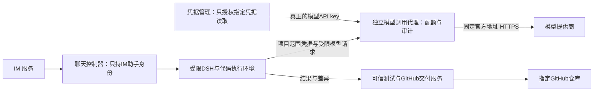

# 云端DSH的密钥与执行边界（建议，未实施）

日期：2026-11-17。用户询问将DSH放在云端后的API key安全。本文件记录方案和当前差距，不代表已经部署、接入凭据服务或完成云端安全验收。本轮不读取真实密钥、不改云资源，不把Windows本机认证拷贝到云端。

## 目标与威胁

保护模型API key、IM助手连接码、GitHub交付凭据、腾讯云凭据及SSH管理身份。主要风险包括：公开服务被入侵、恶意聊天/附件或仓库内容诱导工具读密钥、测试/依赖脚本读取继承环境、日志/备份/镜像泄露以及滥用模型额度。

没有单项配置可以保证绝对安全。密钥不进Git、磁盘加密和TLS分别保护不同环节；进程真正使用密钥时仍能接触明文，获得同等权限的shell或宿主机root不能靠这些措施隔离。

## 建议结构

真实模型key仅由调用代理持有，DSH/代码工具只取得可撤销、项目范围、短期及限额的代理凭据。代理必须校验固定上游地址、允许模型/请求范围、token/金额预算、并发和调用身份，禁止任意URL转发，不记录Authorization及完整敏感请求。代理凭据本身仍是秘密，泄露后也可能被滥用，但损失范围和撤销粒度可受控。原始key不会写入Worker环境、仓库、技能、模型提示或测试容器。

这比“给DSH注入真实key，再要求模型不要读”更可靠。网关和Worker至少不同账号/容器，Worker不拥有宿主机管理权；更强隔离使用独立主机/可信托管边界。同一宿主机root被攻破仍可能接触代理内存和凭据。代理兼容具体DSH认证、流式与工具协议仍需专项验证，当前仓库没有实现它。

## 各类凭据的分配

| 凭据 | 允许持有者 | 建议限制 |
| --- | --- | --- |
| 模型供应商真实API key | 模型调用代理 | 专门团队/项目key，定期轮换；预算不依赖供应商必有“单key硬限额”，由代理强制执行。 |
| 代理临时凭据 | DSH推理进程 | 项目/用途、期限、配额、可撤销；仍禁止进入模型文本/日志。 |
| IM助手连接码 | 聊天控制器 | 只加入指定群，群与成员双授权；代码Worker不能读全群凭据。 |
| GitHub写入凭据 | 独立可信交付服务 | 指定仓库和必要权限；与代码测试进程分开，生产部署另设权限。 |
| 腾讯云访问身份 | 受控凭据读取/运维服务 | 限具体SSM凭据的GetSecretValue等必要操作，不把主账号SecretKey给DSH。 |
| SSH/管理身份 | 运维人员 | 独立管理员、MFA、密钥登录、来源限制；不给编码工具root/sudo/docker管理接口。 |

腾讯云[SSM凭据管理](https://cloud.tencent.com/document/api/1140/40505)支持存储API key等敏感值，并用KMS保护静态数据；[资源级CAM授权](https://cloud.tencent.com/document/product/1140/40871)可限制具体凭据和操作。读取SSM本身也需要身份，不能为避免一把模型key泄露而给Worker另一把全账户云密钥。[CVM实例角色](https://intl.cloud.tencent.com/zh/document/product/213/45917)可使用临时凭据；这是CVM文档，不能由“Lighthouse接入CAM”推断轻量实例支持相同实例角色，部署时需确认实际产品能力。

不使用SSM的较简方案：将密钥存于仓库外、仅专用服务账号可读的文件，运行时只挂给代理；它仍需要访问审计、加密备份、轮换和运维控制。[Docker Compose secrets](https://docs.docker.com/compose/how-tos/use-secrets/)能按服务挂载文件，避免常规环境变量传播，但不是自动加密保险箱，也不能防有读取权限的工具或宿主机root。当前仓库没有SSM或_FILE读取集成，不能只加一段Compose配置就声称接好了。

## 网络、执行和数据

- 对外只暴露实际需要的IM HTTPS入口；SSH限管理员来源或VPN。DSH、daemon、监督控制接口和密钥代理在私网/受限网络，不直接公开管理端口；跨机控制用TLS、独立身份和来源限制。ACME若使用80端口则按选定证书方式单独安排。
- Worker出站通过受控代理/宿主机或容器网络规则，只访问需要的模型代理、代码源/依赖源；对依赖下载单独处理，禁止任意向公网发送。腾讯轻量的[实例防火墙](https://cloud.tencent.com/document/product/1207/44577)主要控制入站，不能靠面板规则宣称出站已隔离。
- 代码工具在非root、无sudo、无Docker socket的独立执行环境中运行，仅挂载任务副本；不挂宿主HOME、云凭据、DSH真实认证或生产数据。项目测试与依赖安装同样属于可执行的不可信代码。DSH推理进程与执行shell进一步隔离，不能共享能读真实key的身份。
- 日志默认不存密钥/Authorization/完整环境，诊断文件也要受限；备份加密、按权限和保留期管理。发现泄露先撤销/轮换原凭据和相关会话，限制出口，核对调用账单及审计；只从Git历史删掉字符串不能使已泄露key失效。
- 定义硬预算、最大并发、每任务模型调用/token上限、超额停用、异常告警与一键撤销。不同key不一定意味着供应商账单/并发隔离，须按实际平台能力确认。
- key不外泄也不等于数据不出站：调用外部模型仍会把选入上下文的代码/聊天交给提供商。上线前确定允许发送的数据、供应商留存政策及脱敏范围。

## 当前代码已做与未做

已有：聊天成员/机器人访问隔离、群和派任务者白名单、部分控制凭据环境剥离、每任务工作副本/会话、可信交付命令和受限remote-tools通路。它们不能替代OS、容器和网络隔离。

明确缺口：installed-headless默认danger-full-access；环境处理是有限键剥离而非全局白名单，GH_TOKEN/GITHUB_TOKEN和自定义密钥没有默认全部移除，DSH真实认证沿用stored/environment路径；原生shell可能读取同身份的环境/认证文件。remote-tools关闭部分本机原生工具并限定命令，但测试仍执行项目代码，仍需部署层隔离和凭据分离。现有工具token按taskId派生，没有TTL或每任务费用限额，不能称为已实现的短期代理凭据。原始事件/工具/诊断也没有通用密钥脱敏保证。本机启动器依赖Windows PowerShell/CLI路径及当前用户DPAPI，Linux云端不能原样复制；当前Docker资料主要部署IM，并未提供经过验收的云端DSH安全成品。

## 实施前的独立验收范围

后续若用户要求落地，应先冻结新版本范围。使用无效的合成凭据做泄露探针：恶意聊天、附件、代码和依赖脚本尝试读env/HOME/凭据目录、访问metadata/代理管理面及外部接收端；验证真实key不可达、出站阻断、越群/越项目拒绝、额度耗尽自动停用、日志和构建产物无秘密、撤销/轮换生效。另验证Linux启动/恢复、跨机TLS与网络断开、执行端身份及准确代码交付，不能把当前Windows单测当云端验收。

参考：[OWASP密钥管理](https://cheatsheetseries.owasp.org/cheatsheets/Secrets_Management_Cheat_Sheet.html)、[AI辅助编码安全](https://cheatsheetseries.owasp.org/cheatsheets/Secure_Coding_with_AI_Cheat_Sheet.html)。以上为设计建议，不是安全认证或已执行结果。
