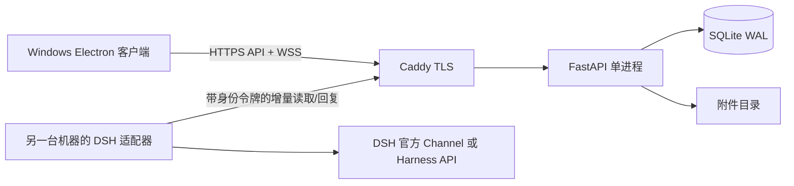

# v0.1 设计冻结（2026-11-07，Asia/Shanghai）

## 范围与验收

交付适合约 5–30 人的小团队内测版。支持管理员创建账号，账号密码登录，用户目录，私聊和群聊，持久文字历史，实时消息，断线后重读历史，发送状态与失败重试。每个附件严格小于 100,000,000 字节（十进制 100 MB，不是 100 MiB）。图片 inline 缩略预览/大图，音频播放器，视频播放器，普通文件下载卡。音频/视频指发送媒体文件；首版不承诺实时通话、转码、语音转写。

DSH 独立机器人账号只可读取已加入的会话。适配器向外连接 IM，腾讯服务器无需访问内网 DSH。事件游标持久化，重启补读；幂等回复；消息触发默认 @dsh 或私聊机器人。真实 harness 执行方式以官方源码验证后补充，不虚构兼容协议。

首版不做公开注册、端到端加密、多人集群、文件断点续传、消息撤回。服务端可读消息以便授权机器人工作。磁盘满/网络失败需在 UI 明确显示失败；不静默伪造消息成功。

## 结构

- Python 3.12+ / FastAPI / SQLite：低运维开销，Linux 容器和 Windows 本机可运行。
- Electron / 原生 HTML、CSS、JS：一份渲染层用于桌面及浏览器验证；Windows 便携包无需 Python。桌面仅连接服务器。
- SQLite 和文件放在持久卷。附件流式写磁盘，上传前校验会话权限，边写边计数、哈希；超过阈值删除临时文件；完成后原子移动并登记。
- 附件读取必须验证用户会话成员资格；可签发短时附件访问票据供媒体播放器 Range 请求使用。不公开静态附件目录。
- 只识别允许 inline 的媒体签名/容器；HTML/SVG/未知内容均当下载文件。媒体不兼容时提供下载。

## UI 规格

视觉借鉴微信/WhatsApp 的信息分区，品牌暂名「同频 / Team Relay」。暖白主背景、浅灰绿色分隔、深绿导航、青绿色主按钮。系统中文字体（Segoe UI / Microsoft YaHei）。普通窗口默认 1280×860，最小 960×680。

从左到右：64px 深绿导航栏（聊天/成员/设置/退出），280px 会话侧栏（搜索、新建会话、头像、摘要、时间、未读标记），自适应聊天区（标题与连接状态、消息流、附件工具栏、文字编辑器、发送按钮），约 250px 可折叠详情栏（成员、机器人、文件与规则提示）。小窗口收起详情栏。

登录页：品牌说明 + 服务器地址 + 用户名 + 密码。只记服务器地址/用户名；令牌默认仅内存存放，退出销毁。消息使用 textContent 渲染。自身气泡浅绿、他人白底，机器人带明确身份标记。上传显示百分比，失败消息提供重试；Enter 发送，Shift+Enter 换行，中文输入法组合中不发送。拖放、选择文件支持多文件逐个上传。

新建会话弹窗支持私聊/群聊和成员选择。成员列表可发起私聊；管理员界面可创建账号/机器人、生成机器人 token（只显示一次）。机器人会话中明确标明监听范围和触发规则。演示内容只可通过显式的隔离 seed 脚本创建。

## 权限、可靠性与部署

- 管理员用 CLI 首次创建，生产无默认密码。密码 PBKDF2/scrypt 等成熟标准哈希；随机高熵 session token，数据库只存 token 哈希；登录节流。
- 所有会话、历史、附件、事件查询按成员关系授权。机器人不得通过请求参数扩大权限。
- 消息具有 client_id，会话+发送者+client_id 唯一约束，HTTP 重试不产生重复消息；服务端递增序号用于排序与增量追赶。
- WebSocket 只负责事件通知，历史数据由 API 补读；握手先获取一次性短期 ticket，不把长期凭据放 URL。
- DSH 事件流不接收自己的机器人消息；适配器保存 cursor。Harness 执行完成才推进游标，重试使用相同 client_id。
- Electron nodeIntegration=false、contextIsolation=true、sandbox=true；CSP，阻止外部导航与任意新窗口。客户端不执行附件。
- 腾讯轻量 Linux：Docker Compose + Caddy，域名/TLS 443；应用端口仅容器内暴露。绑定持久数据，单 worker；备份采用 SQLite backup API + 附件快照。
- 本机仅 127.0.0.1:18200。生产凭据和腾讯地址尚未提供，只准备可审查的部署包，不宣称远程部署完成。

## 阶段

1. v0.1.0-design：设计、协议与恢复文档。
2. v0.1.0：基础实现、真实 API/WS/媒体/隔离测试、桌面构建。
3. v0.1.1：根据测试修复并完成 DSH 真实联调与迭代上传。

## 实施后的补充（v0.1.1）

2026-11-08 的 v0.1.2 将日常界面进一步减负，当前界面以 [UI-v0.1.2.md](UI-v0.1.2.md) 为准：紧凑登录、单附件入口与自增长输入框、低频提示收起、连续消息分组、联系人直接私聊；沿用以下品牌/安全/助手协议。

UI 最新规格以 [UI-v0.1.1.md](UI-v0.1.1.md) 为准：用户要求删除解释性技术文字，采用Impeccable精简，默认收起详情，多图标、必要操作文字与无障碍标签。

DSH实际接缝为官方 `@deepseek-ai/dsh-sdk-client@0.2.2-rc.1` 的stdio JSON-RPC，使用官方签名Desktop内置CLI，不调用未公开的Desktop HTTP接口。按会话恢复session、双白名单、结果缓存与幂等回复；执行中断必须人工决定重试或跳过，不声称分布式exactly-once。真实本地模型文本实验及格式失败边界见 bridge/LOCAL-MODEL-TEST.md。部署运行时依赖也已完整锁定在requirements.lock.txt。
