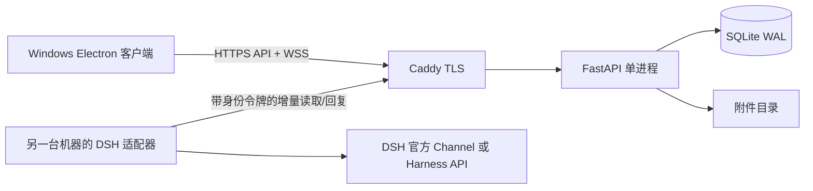

# v0.1 设计冻结（2026-11-07，Asia/Shanghai）

## v0.4.2 覆盖：只观测，不设分析额度

当前规格[QA-MONITORING-v0.4.2](QA-MONITORING-v0.4.2.md)撤销下方QA用量/时长停止条件。累计分析、模型生成、工具、阅读和解析次数均只是观测数据；分页/分批控制单次内存，允许持续读取与动态真实证据。结果仍为skill原文，另发一次简短用量报表。旧额度拒绝且未开始模型的任务自动接续，其余取消/未知终态不重做。文件授权、凭据隔离、原始行/hash核验和聊天100MB约定不变。

## v0.4.1 正向完成与skill原意

当前覆盖规格为[QA-ACCEPTANCE-v0.4.1](QA-ACCEPTANCE-v0.4.1.md)。直接执行固定skill并回传其报告，不加入额外诊断规则，不因缺时间改写模型责任方/置信度。模型报告校验与脱敏后持久保存，显示用中性标题，程序扫描说明保留在运行记录。

冻结证据前最多4批固定解析（每批3文件/16MB/512MB堆），按实际清单回读findings及上下文，流式扫描按文件/类型分配覆盖，业务失败优先于重复成功码和泛异常。扫描及实际证据校验统一2M行/320M字符，匹配既有320MB材料展开范围；模型上下文仍最多60条，Agent仍须实际加载skill、解析和读证据。解析预处理不充当Agent完成证明。验收必须真实模型终稿→正常Outbox→成员下载报告；partial是保留的中间结果，不能作为本轮完成。

## v0.4.0 当前QA日志范围

[QA-IMPLEMENTATION-v0.4.0](QA-IMPLEMENTATION-v0.4.0.md)覆盖下方v0.3.3的QA待实现阶段。日志分析Worker就是业务平台角色，统一Trigger/Router按类型调度；Worker调用skill执行适配服务，由本机DSH Agent实际加载固定skill/日志工具，返回经校验JSON与报告附件，再由统一Outbox回聊天。Pi/Hermes/OpenCode保持可注册协议，未实现的后端如实列出。故障时间可选，缺失仍有界初排；真实/模拟与运行状态按最新HANDOFF/state/报告区分。

## v0.3.3 当前新增范围

[DESKTOP-TRAY-v0.3.3](DESKTOP-TRAY-v0.3.3.md)先冻结再实现Windows托盘、窗口关闭/最小化及后台未读提醒；不迁移外壳或改变石墨布局。QA新Bug按用户要求的Trigger→Router→typed日志Worker→Outbox设计，见[QA-TRIGGER-ROUTE](QA-TRIGGER-ROUTE.md)。本轮日志部分仅设计与本机插件核对，不启用真实来源/批量分析；typed路由不能复用现有code new冒充已实现。安全与已知P1边界继续有效。

## 当前产品与业务流程：v0.3.2

产品显示名称统一为**同频TeamPlay**，范围见[REVIEW-TEAMPLAY-v0.3.2](REVIEW-TEAMPLAY-v0.3.2.md)。根[README](../../README.md)是当前架构、角色、正常交付、补充/取消/恢复、主动核查、权限边界和Super-agent逐项核对的入口。执行机制沿用v0.3.0；上下文全局预算/摘要、老任务召回、补充附件、补充顺序及物理异机长期验收仍有缺口，本轮只如实记录。

更名保留既有app.setName/用户目录、localStorage、协议、npm和TeamRelay.exe路径，不迁移用户资料；Windows可见页面/窗口/PE显示新名。当前沿用远端已选石墨主题且界面精简；下方初版标语/绿色布局均为历史。各日期实际运行与验收以对应报告为准，本轮未启动正式监听或模型。

## UI当前覆盖：v0.1.4

用户已从四套方案选择C石墨，正式落地见UI-v0.1.4.md：深灰/琥珀、紧凑密度和规则六齿设置图标，产品交付v0.3.1。保留业务DOM/操作，单一共享settings SVG覆盖登录连接与导航。深色表面和按钮/覆盖层前景分别令牌化，不能把surface-white同时当亮色文字。下方蓝色说明为历史。

## 当前架构覆盖：v0.3.0

用户要求补齐Super-agent对照中的全部未实现/部分实现项，并明确继续本机。当前新增范围以 [SUPERAGENT-v0.3.0.md](SUPERAGENT-v0.3.0.md) 为准，覆盖下方旧版“单会话串行/仅@/失败离线”的历史说明。

IM保持FastAPI单进程和SQLite/WAL；控制器独立持久账本接纳事件、Router批处理与任务并发、每任务worktree/session、原生next-step输入与消费回执、Thread/引用图召回、独立语义Watchdog、GitHub评审/CI及验证后的PR交付。remote-tools模式可将DSH计算/会话放在控制侧、真实代码/固定工具放在独立daemon；本轮同机不同目录/进程实证，不宣称腾讯已部署。

当前蓝色Windows包升级0.3.0，仅更新交付版本，普通聊天界面保持既有设计。发布流程使用已确认合并的commit和独立checkout；按可信策略运行构建、核对hash、创建不可覆盖的tag/Release。具体模块、边界与证据见各SUPER设计及本轮验收报告。

## 范围与验收

交付适合约 5–30 人的小团队内测版。支持管理员创建账号，账号密码登录，用户目录，私聊和群聊，持久文字历史，实时消息，断线后重读历史，发送状态与失败重试。每个附件严格小于 100,000,000 字节（十进制 100 MB，不是 100 MiB）。图片 inline 缩略预览/大图，音频播放器，视频播放器，普通文件下载卡。音频/视频指发送媒体文件；首版不承诺实时通话、转码、语音转写。

DSH 独立机器人账号只可读取已加入的会话。适配器向外连接 IM，腾讯服务器无需访问内网 DSH。事件游标持久化，重启补读；幂等回复；消息触发默认 @dsh 或私聊机器人。真实 harness 执行方式以官方源码验证后补充，不虚构兼容协议。

首版不做公开注册、端到端加密、多人集群、文件断点续传、消息撤回。服务端可读消息以便授权机器人工作。磁盘满/网络失败需在 UI 明确显示失败；不静默伪造消息成功。

## 结构

- Python 3.12+ / FastAPI / SQLite：低运维开销，Linux 容器和 Windows 本机可运行。
- Electron / 原生 HTML、CSS、JS：一份渲染层用于桌面及浏览器验证；Windows 便携包无需 Python。桌面仅连接服务器。
- SQLite 和文件放在持久卷。附件流式写磁盘，上传前校验会话权限，边写边计数、哈希；超过阈值删除临时文件；完成后原子移动并登记。
- 附件读取必须验证用户会话成员资格；可签发短时附件访问票据供媒体播放器 Range 请求使用。不公开静态附件目录。
- 只识别允许 inline 的媒体签名/容器；HTML/SVG/未知内容均当下载文件。媒体不兼容时提供下载。

## UI 规格

视觉借鉴微信/WhatsApp 的信息分区，品牌暂名「同频 / Team Relay」。暖白主背景、浅灰绿色分隔、深绿导航、青绿色主按钮。系统中文字体（Segoe UI / Microsoft YaHei）。普通窗口默认 1280×860，最小 960×680。

从左到右：64px 深绿导航栏（聊天/成员/设置/退出），280px 会话侧栏（搜索、新建会话、头像、摘要、时间、未读标记），自适应聊天区（标题与连接状态、消息流、附件工具栏、文字编辑器、发送按钮），约 250px 可折叠详情栏（成员、机器人、文件与规则提示）。小窗口收起详情栏。

登录页：品牌说明 + 服务器地址 + 用户名 + 密码。只记服务器地址/用户名；令牌默认仅内存存放，退出销毁。消息使用 textContent 渲染。自身气泡浅绿、他人白底，机器人带明确身份标记。上传显示百分比，失败消息提供重试；Enter 发送，Shift+Enter 换行，中文输入法组合中不发送。拖放、选择文件支持多文件逐个上传。

新建会话弹窗支持私聊/群聊和成员选择。成员列表可发起私聊；管理员界面可创建账号/机器人、生成机器人 token（只显示一次）。机器人会话中明确标明监听范围和触发规则。演示内容只可通过显式的隔离 seed 脚本创建。

## 权限、可靠性与部署

- 管理员用 CLI 首次创建，生产无默认密码。密码 PBKDF2/scrypt 等成熟标准哈希；随机高熵 session token，数据库只存 token 哈希；登录节流。
- 所有会话、历史、附件、事件查询按成员关系授权。机器人不得通过请求参数扩大权限。
- 消息具有 client_id，会话+发送者+client_id 唯一约束，HTTP 重试不产生重复消息；服务端递增序号用于排序与增量追赶。
- WebSocket 只负责事件通知，历史数据由 API 补读；握手先获取一次性短期 ticket，不把长期凭据放 URL。
- DSH 事件流不接收自己的机器人消息；适配器保存 cursor。Harness 执行完成才推进游标，重试使用相同 client_id。
- Electron nodeIntegration=false、contextIsolation=true、sandbox=true；CSP，阻止外部导航与任意新窗口。客户端不执行附件。
- 腾讯轻量 Linux：Docker Compose + Caddy，域名/TLS 443；应用端口仅容器内暴露。绑定持久数据，单 worker；备份采用 SQLite backup API + 附件快照。
- 本机仅 127.0.0.1:18200。生产凭据和腾讯地址尚未提供，只准备可审查的部署包，不宣称远程部署完成。

## 阶段

1. v0.1.0-design：设计、协议与恢复文档。
2. v0.1.0：基础实现、真实 API/WS/媒体/隔离测试、桌面构建。
3. v0.1.1：根据测试修复并完成 DSH 真实联调与迭代上传。

## 实施后的补充（v0.1.1）

2026-11-09 的 v0.1.3 只改变颜色与设计令牌：暖白/绿色改为蓝色主题，登录页与主界面统一，布局、文案、交互和功能不变，当前颜色以 [UI-v0.1.3.md](UI-v0.1.3.md) 为准。旧绿色主色令牌、绿色调表面和 logo 绿色已移除；语义错误红与警告琥珀保留。桌面安装包仍是 v0.1.2 绿色版本，重建后才包含蓝色主题。

UI 的布局、减负与图标依据仍是 [UI-v0.1.2.md](UI-v0.1.2.md) 和 [UI-v0.1.1.md](UI-v0.1.1.md)：用户要求删除解释性技术文字，默认收起详情，多图标、必要操作文字与无障碍标签。

DSH实际接缝为官方 `@deepseek-ai/dsh-sdk-client@0.2.2-rc.1` 的stdio JSON-RPC，使用官方签名Desktop内置CLI，不调用未公开的Desktop HTTP接口。按会话恢复session、双白名单、结果缓存与幂等回复；执行中断必须人工决定重试或跳过，不声称分布式exactly-once。真实本地模型文本实验及格式失败边界见 bridge/LOCAL-MODEL-TEST.md。部署运行时依赖也已完整锁定在requirements.lock.txt。

当前待审核的独立风格方案见UI-REVIEW-2026-11-10.md；正式App仍沿用UI-v0.1.3，用户选择后再实施。
# 2026-11-21：同频作为业务路由中心

用户确认目标是插件化、多Agent的业务协作入口。聊天和业务系统事件由Trigger接入；Router识别请求、任务关联与可用能力，把业务任务交给注册的Worker。Worker组合执行Agent、Skill流程和MCP业务工具，保存结果及文件，再通过统一回传通道发布到原聊天。Agent、Skill和MCP不是三个平行的业务角色：Agent执行，Skill规定流程，MCP提供数据和操作；Worker负责一次业务任务的输入与交付。

例如QA新Bug由轮询Trigger发现，Router按项目/群绑定派给日志Worker；Worker经QA MCP取材料，调用完整原DSH日志插件配方，聊天只回原结论与完整报告下载。代码任务、数据查询可注册各自Worker，不要求每个任务同时调用多个Agent，也不要求每条普通消息调用模型。

当前QA按typed规则路由，已有代码任务使用分类器；通用AI基于能力描述动态选择任意Worker、跨Worker自动编排仍是后续范围。先完成当前日志链路的原插件等价验收，不把这个产品方向描述成已全部实现。

## v0.5.1 模型控制、原生历史及每轮打包

本轮实施范围先冻结于DELIVERY-v0.5.1。DSH模型控制由共享dsh-model-selection统一max，原生不支持则明确失败；QA仍整包CLI和原system/user，只把思考与正文容量交还原生目录值，旧recipe值独立审计。

Pi原JSONL保留任务目录，向原生共享home/sessions登记独立目录junction并核对目标，桌面同一scanner可枚举；Hermes保留tool/acp来源，原生/title零模型命名，使用全部/自动化列表查看。命名是控制操作，不混入Worker最终文本。已有真实会话补登记先备份、核对原nativeID、非标题历史及用量不变，不复制历史或伪造会话。

每轮Windows便携目录/版本ZIP/SHA由deliver-windows统一生成，旧入口兼容；ASAR白名单/字节、PE、ZIP全文件hash及隔离真实EXE/托盘/报告下载全部通过才可发Release。源码tag和包必须对应版本，包不含服务、Agent、账号或原始材料。
