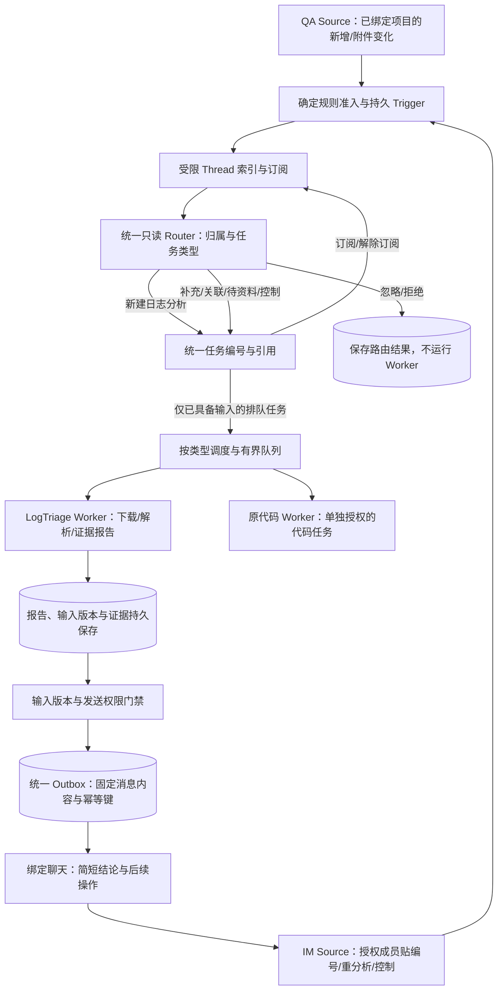

# QA 新缺陷 → Trigger → Router → 日志分析 → 聊天回传

日期：2026-11-20。本文保留初版流程与研究边界。**v0.4.0已进入实现，当前规范以[QA-IMPLEMENTATION-v0.4.0](QA-IMPLEMENTATION-v0.4.0.md)覆盖本文阶段和时间准入说明。** 用户后续明确：故障时间可选，缺失时仍需初排；“业务平台”具体是Super-agent日志分析Worker，执行适配层调用本机Agent加载skill及受控工具。本文“本轮仅设计/待实现”和缺时间即等待的旧段落属于历史，不是当前运行结论。实际实现/测试/试点状态以最新HANDOFF和v0.4.0报告为准。本文示例均为合成数据。

用户已选择两种入口：**QA 系统新增缺陷自动触发**，以及**授权群里贴缺陷编号请求重分析**。两者必须经过统一的 Super-agent Trigger + Route；不能做成“定时发现 Bug 后绕过 Router 直接调用模型”。

## 1. 已核对的现状与复用范围

- 本地 DSH 日志插件具备“取得缺陷附件 → 下载/解包 → 固定解析 CLI → 证据驱动的模型报告”的手动流程。解析产物可以复用，受控下载/解包、任务持久化及自动触发需新增。
- 插件的 `/triage/issue`、`/triage/analyze` 是 Desktop 插件内部注册的 UI 路由；报告函数依赖 Desktop 的 LLM 上下文，不是 QA MCP 工具或已验证的公开后台服务。不得直接调用私有 Desktop 接口、复用插件默认登录身份或接管用户正在使用的会话。
- QA MCP 已有项目/缺陷分页列表、附件 ID、附件地址等只读能力。目前未发现可靠的 webhook、事件游标或 `updatedSince` 参数；列表排序/分页稳定性仍需契约验证。详细正文也不能假定有 `issue_get` 工具，实施时需验证受支持的取得方式。
- 现有 `SuperRouter` 只判断 IM 事件与代码事项；`SuperCoordinator` 的 `new` 默认会进入代码 Worker，可能继续 GitHub 交付。不能把 QA 缺陷伪装成人类 IM 消息塞入这个入口。
- 插件现有报告阶段的 effort 主要限制证据条目与输出，未形成完整输入 token/字符预算。新适配必须对症状、提取证据、关键行、引用摘要及工具描述合计限额，不能把旧拼接流程照搬后宣称成本有界。解析脚本为CommonJS；移入ESM工程时需显式保留模块边界，并将必要适配标为审核差异。
- 可以复用 `StateStore` 的持久写入/锁、协调器串行事务、任务编号/引用、独立路由与执行循环、受限 DSH 传输及 Outbox 模式。需要扩展来源契约、任务类型和专用日志执行器，复用不等于这些能力已经接好。
- 机器人通过现有消息 API 可向已加入的聊天发送普通文字；稳定 `client_id` 在会话/发送者作用域内去重。当前聊天正文按纯文字渲染，不能把新卡片按钮、Markdown 或可点击链接视为已有能力。

### 分析版本必须固定

已观察到本机日志 skill/解析材料为 **1.2.0**，用户提供的站点为 **1.3.2**。目标行为采用 **1.3.2**；实施前必须保存其准确来源、版本/摘要与解析依赖，并专项验证 TBOX UTC 与 QNX/DE 本地时间、epoch 交叉核验等时间行为。可选择经过审核的本地 parser 副本，但须明确其版本和行为差异，不能把旧 parser 的输出标成 1.3.2。

日期、时区或故障窗口不足时进入“待补充”，不得按报告生成时间猜测故障发生日期。技能及工具输出属于资料，不能更改群授权、项目、预算、路径、认证或执行规则。

## 2. 统一架构



QA Source 的有界轮询只负责取得变化、去重并生成 Trigger；模型不在扫描函数中调用。之后与 IM Trigger 使用同一套 Router、任务关联、调度、控制与 Outbox。日志任务不能因同一个协调器存在代码功能，就自动创建代码副本、提交 PR、自动合并或发布。

QA 是具有单独授权的来源服务主体，不伪造人类发送者。IM 控制仍要求真实成员、允许的聊天与允许的操作者；QA 自动来源要求已授权来源、固定项目和对应输出群。两种来源的准入规则分别验证。

## 3. 类型与权限契约

### 3.1 绑定配置

在忽略的本机配置中明确保存 `sourceId → qaProjectId → conversationId → botId`，另列允许手动触发/控制的成员、缺陷范围、解析版本、并发和资源预算。示例来源名为 `qa-demo`，项目名为 `demo-project`，缺陷编号为 `DEMO-42`；不得把真实项目名、缺陷正文、附件地址或凭据写进 Git。

默认仅启用显式绑定的项目。项目列表里“可见”不等于被授权监听或向某个群公开其日志；不得因截图展示很多项目就自动全部分析。群成员能看到报告的范围也必须与该 QA 项目数据权限匹配。

**只读来源服务主体**是管理员为一个 `sourceId` 配置的 QA 读取身份及授权策略，不是缺陷创建人，也不是 IM 群成员的替身。它仅可读取批准项目的列表、必要正文和附件，不能修改/评论/关闭缺陷、取得无关项目数据或借缺陷正文更改授权。QA 读取凭据留在来源适配器/受控读取服务，Trigger 仅记录主体引用和当次授权范围，不保存凭据。模型报告与聊天发送分别使用自己的受限身份；来源“只读”不代表协调器不能持久写本地账本，也不意味着来源拥有向任意群发送消息的权力。

### 3.2 Trigger

建议统一 envelope：

```json
{
  "triggerId": "qa:qa-demo:demo-project:issue-42:new:revision-a",
  "sourceKind": "qa",
  "sourceId": "qa-demo",
  "eventKind": "issue.created",
  "projectId": "demo-project",
  "externalIssueId": "issue-42",
  "externalIssueNo": "DEMO-42",
  "conversationId": "bound-demo-chat",
  "observedAt": "2026-11-20T02:00:00Z",
  "sourceRevision": "revision-a",
  "reference": "trigger:demo-reference"
}
```

`triggerId` 是跨来源唯一字符串，不复用 QA 的数值 ID 来冒充 IM 消息 ID。所有字段由来源适配器规范化，并以可信绑定确认项目/聊天；模型只能读资料，不能决定群地址或认证。原始 IM 消息 ID 及 QA ID 保存在各自引用内，旧任务/会话记录不得覆盖。

QA 事件可为 `issue.created`、`issue.attachments_changed`、`issue.closed`；IM 入口产生对应的 `analysis.requested`、`analysis.reanalyse`、状态/取消/继续等 Trigger。没有可验证增量版本号时，`sourceRevision` 是规范化详情及附件元数据的摘要，不假装是后端保证的版本；实际下载证据另有 SHA256。

### 3.3 Route 与 Task

路由分两层：

1. 确定规则：来源/项目/群/成员授权，重复事件，明确缺陷编号与同群任务引用，已关闭状态，运行预算，已验证的控制指令。
2. 只读语义 Router：`new`、`followup`、`attach`、`ignore`、`need_info`、`status`、`stop`、`resume`；给出允许范围内的归属和简短理由。规则已确定的路由可由 Router 的确定通道返回，不必为每个重复事件付费调用模型。

Route schema 需增加 `triggerId`、`taskKind` 和受校验的目标 `taskId`。统一 Task 至少保存 `id/kind/projectId/conversationId/sourceReferences/externalIssueKey/inputRevision/reportRevision/status`。新类型为 `kind=log-triage`；既有无 kind 的旧任务按兼容迁移认定为 code，不能把旧未完成任务重新分配成日志任务。

对 QA 来源，部署策略只允许 `log-triage`。即使缺陷正文写“提交代码/发布”，也不能给它升级代码、云资源或 Git 权限。用户以后若希望基于分析结果改代码，应产生新的、明确授权的 code Trigger，并保留父任务引用；本轮没有设计自动修复链的默认授权。

同一绑定的同一缺陷有独立关联索引 `sourceId/projectId/issueId → taskId`。新日志/群补充进入原分析任务的新输入版本；跨项目或跨群不能仅靠相同编号合并。编号模糊或出现多个候选时询问具体编号，不猜测。

### 3.4 Thread、订阅与跨来源连续性

QA 缺陷 Thread 是一个长期归属标识，例如 `thread:qa:qa-demo:demo-project:issue-42`；它不是一次扫描或一个模型会话。IM 贴编号产生的请求也有逻辑请求 Thread，记录所属聊天与原始请求消息；现有 IM 没有原生话题 UI，不能把这个内部关联称为已经提供聊天分支界面。

- 新建日志任务时，由 Router 的有效决定建立 `Task ↔ QA Thread` 订阅，并关联发起该任务的 IM 请求 Thread（如有）。QA 附件变化、明确的群补充/重分析/控制沿这个订阅找到原任务，保留跨 QA 与聊天的连续上下文。
- 已有明确订阅的事件进入 Router 的确定通道并持久记录 `followup/status/stop` 等决定；无订阅或归属模糊的事件才交语义判断。订阅不是绕过准入、输入 revision 和权限门禁直接启动 Worker 的快捷后门。
- 首期同一绑定的同一缺陷仅保留一个活跃日志任务，避免 QA 更新与群贴编号同时重复派发。引用模型可表达一个任务关联多个 Thread；若未来允许一个 Thread 分发给多个任务，必须保存每条订阅的目的、授权范围和输入去重键，不能把“同项目/同群”当作订阅全部消息的理由。
- 引用图同时保存 `Trigger → Thread`、`Thread → Trigger/Task`、`Task → Thread/报告` 等受限边，按项目和聊天权限逐跳续读；避免沿用旧实现仅有单向关联、从 Thread 找不到 Task 的缺口。引用分片/页大小及整体上下文预算仍需显式限制。
- 任务完成不丢弃缺陷关联：后续新材料可在同任务建立报告新版本，或按冻结策略建立有父引用的后续任务。取消、来源解绑、权限撤销或订阅移除后，不再自动派发该订阅；账本和已授权历史证据保留，不换群、不假借其他成员身份继续。

Thread 与订阅均为拟扩展的持久领域记录，不声称当前协调器已完整实现。`need_info` 可以把已确认归属的日志任务置为 waiting_input，或生成与原 Trigger 关联的补充请求；不得仅为提问启动解析/模型执行。

## 4. 从新 Bug 到报告

1. **建立基线。** 绑定后完整取得允许项目的初始清单，保存已见 ID/元数据，历史缺陷不自动分析；基线未完整成功前显示“尚未开始监听”。扫描期间新建事件的分界需利用经过验证的排序/新建时间语义；不得用不稳定分页的最后一条记录冒充可靠游标。
2. **发现变化并入账。** 已验证的 webhook 若以后存在，可作为来源；当前方案是有界轮询、重叠读取与周期补偿扫描。只有事件和引用持久保存成功后才推进来源检查点，网络或分页失败不跳过未知数据。轮询只能发现扫描时可见的记录，不能保证捕获两次扫描之间已新建又删除的缺陷；如需完整审计事件，QA 侧需要事件流能力。
3. **准入与 Router。** 新 Bug 的固定项目映射、自动分析策略和归属经 Router 返回 `new log-triage`；重复或无关更新为 ignore，原事项补充为 followup，资料不足为 need_info。统一任务入队并取得编号。
4. **取得输入快照。** 收集症状、软件/版本、故障日期、时区、时间窗口、附件 ID 与类型。缺日志先进入待日志；日期/窗口有歧义进入待补充，不为“尽快完成”擅自猜日期。详细正文取得方式必须使用验证过的接口，不能假定 MCP 列表必含完整正文。
5. **受控下载与解析。** 仅对允许来源获取附件，验证地址/重定向/大小和实际字节；附件地址可能可匿名下载，禁止把它发入群、报告或模型提示。为每个真实文件计算 SHA256，保存不可变证据清单，然后运行固定解析 CLI。元数据中的 MD5 是可选线索，不能代替实际证据哈希。
6. **专用只读分析。** 使用固定 skill/parser 行为和证据生成初步判断、依据、不确定点及建议。解析器可写自己独立临时输出目录，但不能写业务仓库；模型阶段不给通用编码、Git、发布或任意 shell 权限。可复用受控 headless DSH 的传输，但报告适配器与权限需专项验证，不声称当前 Desktop 模型函数可以直接搬到后台。
7. **校验与持久保存。** 结构化输出必须含实际使用的输入版本、文件名/哈希、时间窗口、关键行/时间戳引用、结论与缺口。无法从证据支持的根因写“待验证”；解析失败/缺材料不能写成分析成功。报告先持久保存，之后才安排聊天输出。
8. **回传。** 在固定群中发送短摘要，完整报告按任务引用保存/按需读取。发送前重新确认来源与群绑定、机器人身份/成员关系及报告对应输入版本。发送失败进入 Outbox 重试，不重复运行解析或模型；临时链接失效也不应重做已完成的模型报告。

## 5. 状态、补充与恢复

建议状态：`observed → routing → waiting_log / waiting_input / queued → preparing → analysing → validating → completed → reporting → reported`；异常为 `retry_wait`、`paused`、`uncertain`、`failed`、`cancelled`。状态名称只用于管理/账本，普通聊天显示“等待日志”“需要补充”“排队中”“正在分析”“分析完成”“已暂停”等。

- **附件迟到：** 新 Bug 无日志只通知一次并保存任务，不反复启动模型。追踪该任务的附件变化；后来补日志生成新 Trigger、Router 归回原任务并递增 `inputRevision`。已完成任务追加附件默认形成新的报告版本；是否自动重分析由绑定策略限制，不因一般评论/负责人变化无限运行。
- **手动重分析：** 授权成员发“重新分析 DEMO-42”产生新请求 Trigger。请求去重按 IM 消息 ID；每个明确新请求可生成新 attempt，旧请求重投不重复收费。没有新证据时可告知“日志没有变化”，是否仍重跑需按明确请求和预算判断，不能偷偷无限重试。
- **取消/继续：** 先记控制，再停止本任务拥有的计算；已有证据/报告保留。继续先核验原执行是否终止与已完成阶段，再恢复未完成步骤。未确认停止时为 uncertain，不能创建第二个相同分析进程冒充恢复。
- **QA 暂不可达：** 保存最后成功检查点和退避时间，不能据此声称“没有新 Bug”。低频向管理者/指定群提示“暂时无法连接问题系统，任务已保留”；恢复仅发送一次恢复通知。普通分析与代码任务不因来源故障整体阻塞。
- **缺陷关闭：** 按策略停止尚未开始的自动任务，运行中报告只针对已冻结证据，不得把“缺陷关闭”解释为日志根因已确认。授权的手动历史重分析仍走单独显式请求。

### 输入 revision 门禁：避免沿用 A1 的遗漏窗口

每次实际材料/要求改变，协调事务递增 `inputRevision`。Worker 启动时冻结 `includedRevision` 和证据清单；结果带 `reportRevision`。在进入 completed、建立结果 Outbox、发送结果前，都要比对当前输入版本和任务代次。

若运行/验证/回传期间收到新日志，不能只回复“已加入”后结束：未发送的旧结果标为旧版本并排队后续分析；旧结果若已发出，明确其对应的证据版本，同时保留同任务的新一轮更新。即使副作用已发生，也必须有可追踪后续 attempt，不丢弃新 Trigger。不得承诺目前代码已具备此门禁；这是实现前验收要求。

### 可靠 Outbox

Outbox 与结果在同一协调事务入账，包含固定 `conversationId/part/body/bodyHash/clientId/reportRevision`。`clientId` 使用绑定/任务/报告版本/分片的稳定摘要，满足现有字符与长度限制；不能在发送重试时随机生成，也不能改正文继续复用同一键。丢失确认后重发同一内容，消息 API 的幂等约束负责避免重复；409冲突进入人工核查，不换键绕过。

发送阶段再检查权限。群被解绑/机器人被移出时，保留报告并暂停发送，不改投其他群。机器人报告不会再触发分析自身。发送成功不代表用户已读，托盘新消息提醒由客户端独立处理，不成为任务完成判据。

## 6. 数据与执行隔离

- QA 身份只读指定项目，IM 身份只负责绑定群的消息，DSH 模型认证和控制凭据分别保存于忽略配置/受限认证服务。分析 Worker 不拿 GitHub 写入、自动合并、云管理或任意项目权限。
- 原始日志、模型输入/输出、报告和来源检查点均为私有运行数据，保存于忽略目录并按权限/保留期管理；Git 只提交示例配置、设计和脱敏验收。任务输出不能泄露附件匿名地址、身份凭据或宿主机绝对路径。
- 下载/解包应重新建立大小、总字节、文件数、扩展体积、嵌套深度、墙钟时间及并发上限。拒绝路径逃逸、符号/硬链接、重解析点和超预算压缩包；来源文本不得拼进 shell。现有插件直接下载/解包流程不提供这些充分保证，不能直接照搬。
- QA 取数/解包预算与 IM 每文件严格小于100,000,000字节的发送上限是不同限制。首期只发精简文字报告，不自动上传原始日志；若以后附报告文件，仍逐项校验 IM 大小和访问权限。
- 固定命令依然会执行代码；解析工具及最小验收 runner 应由 Worker 不可改写的审核版本提供，不能让任务修改自己的证据校验入口。与现有 A2 类似的“可改弱验收”不得进入新流程。
- 会话/工作目录隔离不是 OS 沙箱。后台分析需受限执行身份/环境和出口策略；模型可能接触业务日志，数据发送范围须明确授权。本文不把现有云安全建议称为已实现。

## 7. 队列、账本与模块分工

统一账本保存来源基线/检查点、Trigger、Thread、订阅、路由决定、Task、输入 revision、报告引用与 Outbox；每步由单写入事务推进。日志运行文件使用独立目录和单任务锁；独立文件或进程不能仅在内存中维护“已处理”，也不能先推进 QA 检查点后再保存 Trigger。

建议初期只绑定一个合成项目，日志分析并发1，并配置轮询/退避、下载/解包、模型调用/token、单次时间和每日运行预算。具体上线值需按真实工具特性冻结；无预算不得启用自动源。来源扫描与路由不等待慢解析或模型，日志池不挤占代码池的全部执行容量。

| 模块建议 | 责任与隔离 |
| --- | --- |
| `qa-source.mjs`、`qa-adapter.mjs` | 只读取允许项目，验证分页/附件契约，规范化变化，产生Trigger；不调用模型。 |
| `super-trigger.mjs` 或等效来源层 | 统一来源身份、引用、去重、准入和持久接收；兼容IM/GitHub现有来源。 |
| 扩展 `super-router.mjs` | typed route验证、确定通道和只读语义路由；限制候选/类型/归属，新增need_info而不放宽权限。 |
| 扩展 `super-coordinator.mjs` | 统一任务号/关联、输入revision、按kind调度和Outbox；code/triage分别分支，日志任务永不调用GitDelivery。 |
| `log-triage-worker.mjs` | 固定受控解析、证据快照、版本固定与只读模型报告；独立有界执行与恢复。 |
| `triage-report.mjs` 或等效纯格式层 | 输出schema/证据引用/长度/脱敏与普通聊天摘要；保存完整报告。 |

这些是拟新增或扩展的模块，不是本轮已创建源码。迁移需保留旧任务号、输入、session/worktree/锁和未完成任务；来源及task.kind等schema变化单独验证，不能重置旧账本换取“干净运行”。

## 8. 聊天里的表达

示例只使用普通业务文字，不显示MCP/Router/Trigger等架构术语：

```text
DEMO-42 已收到，正在检查日志。

DEMO-42 需要补充：故障发生日期、时间，以及设备使用的时区。

DEMO-42 初步分析完成
判断：升级过程可能在条件检查阶段中断，原因仍需验证。
依据：demo.log 第120–128行，示例时间窗口内出现两次条件拒绝。
建议：核对同一时刻的状态记录，并补充对端日志。
本次使用：示例日志A。新补充的日志B正在继续分析。
完整分析：发送“分析详情 #T000042”。
```

长报告通过统一详情命令按权限读取，必要时分片，每片保留固定版本和幂等键。当前普通文字渲染不会自动产生新的卡片/链接按钮；若需要可点击QA问题链接或“重分析”按钮，应另列UI范围和验收。

## 9. 可观察的验收标准与证据等级

1. **来源契约：** 用合成项目验证项目过滤、稳定ID/排序、分页变化、基线期间插入、断页重试及重叠补偿；既有缺陷0次模型调用，新缺陷恰好1个持久Trigger。没有相应API保证时明确轮询边界，不假称可靠事件游标。
2. **统一路由：** QA新增和群贴编号都留下Trigger、route决定和统一taskId；model调用只在路由批准后出现。QA内容试图指定code/Git/群/目录被拒绝。无法归属时need_info而不乱挂任务。验证QA Thread与IM请求Thread关联、确定通道订阅续接、双向逐跳召回、重启后订阅保留与跨群不可达；取消/解绑后不再自动分发。
3. **准入隔离：** 未绑定项目、跨项目相同编号、未授权成员、错误群/机器人、来源身份变化、匿名附件地址跨站重定向均不触发或不泄露数据。QA来源使用独立只读服务主体，不能把缺陷创建人名称冒充IM人类授权，也不得从缺陷文本扩大权限。
4. **迟到材料：** 无日志先waiting_log且0次模型；补日志后同任务新revision。重复附件/重复Trigger不重复调用；正文小修改与真正新证据按明确策略处理。
5. **输入门禁：** 在解析、模型、验证、Outbox建立、发送前后分别注入补充；每条输入要么进入本次证据清单，要么保留可观察后续attempt，不能出现“确认后永远没分析”。覆盖多条补充的确定顺序。
6. **输出幂等：** 真实隔离IM消息API模拟提交成功但ACK丢失、发送后崩溃、分片中断；重启只重发原正文/键，最终每片1条消息、0次重复模型。撤销群权限后不发送、不改群。
7. **资源/恶意输入：** 超大下载、错哈希、无MD5、zip路径逃逸/链接/膨胀/嵌套、超文件数、超时、命令注入及日志提示注入；明确失败状态，无仓库变更、无Git交付、无凭据/原始地址外泄。
8. **时间/技能：** 固定1.3.2目标材料和确切parser版本，覆盖UTC/本地混合、epoch、跨日、时间偏差、日期/时区缺失；不得按报告时间补造结论。输出证据行和实际窗口可由独立断言核对。
9. **执行/恢复：** QA断网退避不推进丢失数据，模型中断变uncertain/paused，取消需要终态证据；同任务跨实例互斥，重启不自动重做不确定的收费调用，原报告可独立重发。
10. **有限真实链路：** 最后再显式授权一个合成QA缺陷、一组脱敏日志、一个指定测试群，限定Router/分析会话次数，验证QA→Trigger→route→解析→真实报告→持久结果→IM；记录真实调用及未执行项，不能把默认单测/假模型当此证据。

## 10. 分期与启用条件

- **本轮：** 仅设计与本机实现核对。没有新增自动监听，没有真实QA缺陷分析或聊天发送；桌面托盘功能是另一独立实施范围。
- **实现期：** 先来源/契约/typed路由/持久任务与Fake分析器，再受控parser和只读模型适配，最后Outbox、revision门禁、恢复及安全边界；使用隔离数据完成上述回归。
- **有限试点：** 明确选一个QA项目与输出测试群、操作者与预算，完成时间行为及真实链路验收。未配置映射/预算、MCP不可达、解析版本不明或凭据隔离不足时不得默认启用。
- **扩大范围：** 根据试点证据逐项增加项目/日志类型/并发；默认不自动修代码、不改缺陷状态、不回写QA、不合并发布。后续需要这些行为必须另行冻结业务与权限范围。

相关实现入口：`workspace/bridge/super-router.mjs`、`super-coordinator.mjs`、`state.mjs`、`core.mjs`及`workspace/server/app.py`。本机/公开技能核对来源见[QA-TRIAGE-SOURCES](../../references/QA-TRIAGE-SOURCES.md)。已知Super-agent缺口见 `outputs/AUDIT-SUPERAGENT-v0.3.1-2026-11-10.md`，云端凭据建议见 `CLOUD-SECURITY.md`；本设计没有将其标记为已修复。
