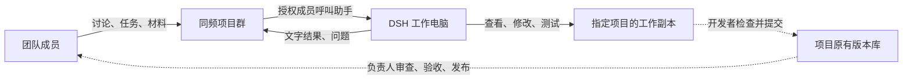

# 团队、同频、DSH 与代码项目如何协作

日期：2026-11-07（Asia/Shanghai）。依据 v0.1.1 的现有实现整理。本文说明协作方式，不代表已经完成所有代码执行与发布自动化。

## 各自负责什么

人决定要做什么、结果是否合格；同频把讨论与任务集中起来；DSH 在指定项目里完成被交给它的工作；原有版本库保存正式代码与修改记录。

| 参与者 | 职责 |
| --- | --- |
| 你和团队成员 | 讨论问题、补充材料、明确任务与验收条件 |
| 同频 IM | 保存聊天和附件，让成员与助手在同一个聊天中交流 |
| 运行 DSH 的电脑 | 保存准备给助手使用的项目工作副本，运行助手并回传文字结果 |
| 项目工作副本 | 实际查看、修改、测试代码的地方；不是 IM 服务器上的聊天记录 |
| 项目负责人、开发者或审查者 | 核对修改和测试证据，决定提交、合并与发布 |
| 项目原有版本库 | 保存正式历史；可以是 GitHub、其他 Git 平台或 SVN，不要求统一迁移 |

IM 服务器可以放在腾讯轻量服务器上；团队在各自的 Windows 电脑上聊天；DSH 可以运行在另一台工作电脑上。DSH 的连接程序主动连接 IM，腾讯服务器不需要直接访问 DSH 的桌面窗口。

实线表示当前接入路径；虚线表示建议采用的人工交付步骤，尚未由桥接程序自动完成。

## 团队怎样交任务

建议一个项目建立一个项目群，把助手加入需要它参与的聊天。管理员配置允许参与的聊天、允许派任务的成员，以及 DSH 要使用的项目目录。加入群聊本身不等于获得派任务权限。

正常讨论照常进行。需要助手工作时，授权成员点击助手图标后写任务，或在群里发送 `@dsh ` 加任务；与助手私聊也可以触发，但该私聊同样必须先被允许。其他机器人发出的消息不会再触发助手。

任务最好一次写清四件事：**哪个项目、要解决什么、做到什么程度算完成、哪些操作先不要做。** 当前程序不会把所有普通群聊自动整理后交给模型，因此不要只说“按刚才说的做”，应把必要背景整理进任务消息。

助手实际收到的附件会下载到自己的工作目录；合适的小图片也可交给模型查看。**目前界面发文件与发文字是两条独立消息，群里“先发文件，再呼叫助手”不会自动把前一个文件带入任务。** 先把关键信息写进任务文字，或在已授权的助手私聊中处理文件；群附件加说明、引用前条文件作为任务材料需要后续补齐。传送文件成功也不等于已有音频转写、视频理解能力。当前自动回传的是文字结果，生成的文件不会自动上传回群。

## 以修复 TinyPM 问题为例

以下是假设场景，不表示 TinyPM 目前确实存在此问题，也不表示已经验收了自动改代码流程。

1. 开发者先在 DSH 电脑上准备 TinyPM 工作副本。如果项目使用 Git，先建立本次任务的独立分支；不要直接让多人共用的开发目录承接试验。
2. 成员在项目群发出：`@dsh TinyPM 上传后列表没有更新。复现步骤：打开列表、上传文件、观察列表，手动刷新后才出现。请先定位原因，给出修改方案和测试办法，先不要提交代码。`
3. DSH 在配置好的目录中处理任务，通过同频回复方案；需要补充资料时，团队继续发送明确的新消息。
4. 负责人确认范围后，另发一条具体修改任务。拥有合适工具权限的 DSH 可按配置执行；当前版本对真实代码修改、测试工具的完整交付仍需另做验收。
5. 开发者检查真实代码差异与测试结果，再提交到该项目原有远端。支持审查请求的平台可走审查请求；使用 SVN 或其他流程时，可提交差异文件、补丁或按原流程审查。负责人决定是否合并和发布，并把验收结果回到群里。

IM 管理员负责账号和助手接入；谁能批准代码，应由项目负责人制度决定，当前没有自动把这两种职责合为一种权限。模型要求额外操作权限时，桥接会拒绝并提示人处理，群里回复一句“同意”不会自动放开该权限。

## 当前能力与下一步建议

**已经具备：** 多人文字与附件交流，指定聊天和指定成员的任务触发，按聊天保留助手对话，任务结果文字回传，重启后的消息接续与结果重发保护。官方 DSH 和已有本地模型的基础文字链路已实测；一次真实 IM 回复多带了前缀，严格格式检查失败，已如实记录。

**目前的边界：** 一个桥接实例只配置一个项目工作目录，任务按顺序处理。不同聊天有各自的助手对话，但不会因此得到不同的代码目录。桥接没有内置自动识别父目录全部项目、选择项目、创建任务工作副本、创建审查请求或合并上线的流程。若操作者另外赋予 DSH 相应工具、凭据并交给它具体任务，模型仍可能执行 Git 等操作；不能把“桥接未内置自动提交”理解为“模型绝不可能提交”。复杂代码任务、工具执行与媒体理解尚未完整验收。

建议先从一个项目群、一个明确项目目录和少量授权成员开始。需要多项目时，先为不同项目准备独立助手、配置、状态和工作目录；不要仅靠多个群名来隔离代码。若以后要共用一个助手自动选择多个项目，需要单独设计项目绑定与任务调度。

`walcracia/agent_bot_im` 是这个 IM 工具自己的仓库。当前把 IM 各版本上传该仓库，是开发本工具的发布工作，不表示 DSH 已能自动把你其他项目的修改推送到这里。其他项目继续沿用各自原有的版本库和交付流程。
